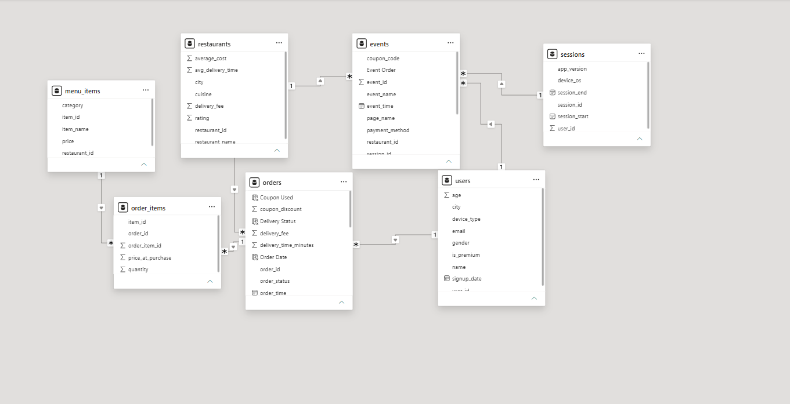

# 🍽️ Zomato Funnel Analytics | Product Analytics Case Study

**An end-to-end, SQL-driven product analytics project** that simulates a food-delivery app's customer journey, identifies conversion bottlenecks, and translates behavioral data into actionable product recommendations.

`Product Analytics` · `Funnel Analysis` · `SQL` · `Python` · `Power BI` · `Customer Retention` · `Revenue Analytics`

> **Data disclosure:** This is an independent educational project using **synthetic data**, not Zomato's internal customer or transaction data. All results describe the simulated dataset and should not be interpreted as actual Zomato performance.

## 📌 Executive Summary

The central question: **Where are users dropping off between opening a food-delivery app and successfully placing an order—and what should the product team investigate first?**

I designed a relational MySQL database, generated realistic-looking user, restaurant, session, event, and order records, wrote ten business-focused SQL analyses, explored the data in Python, and created a Power BI report.

### Key results

| Metric | Result | Interpretation |
| --- | ---: | --- |
| Simulated users | **5,000** | Customer base across 10 Indian cities |
| App sessions | **50,000** | Starting point for the session-based funnel |
| Session-to-order conversion | **22.87%** | 11,435 successful orders from 50,000 sessions |
| Largest funnel drop-off | **44.81%** | Menu View → Add to Cart |
| Cart-to-order completion with a coupon | **73.92%** | Compared with 57.82% without a coupon |
| Repeat-purchase rate | **73.91%** | Among customers who placed a successful order |

The primary opportunity is the **Menu View → Add to Cart** stage. Almost 45% of sessions that reach a menu stop before adding an item, suggesting that menu presentation, pricing clarity, recommendations, and item discovery are useful areas for product experiments.

## 🔍 Product Questions Answered

1. At which step in the ordering funnel do users drop off most?
2. Does conversion differ by **city** or **device**?
3. How is **coupon usage** associated with order completion, discount cost, and revenue?
4. Which **payment methods** have higher failure rates?
5. Is **delivery delay** associated with restaurant rating?
6. Do **premium** users reorder more often than regular users?
7. Which **cities** and **cuisines** contribute the most GMV?

## 📊 Conversion Funnel

The funnel is measured using **distinct sessions** reaching each event. The drop-off percentage is calculated relative to the immediately preceding stage.

| Funnel stage | Sessions | % of initial sessions | Drop-off from previous stage |
| --- | ---: | ---: | ---: |
| App Open | 50,000 | 100.00% | — |
| Restaurant View | 37,571 | 75.14% | 24.86% |
| Menu View | 30,920 | 61.84% | 17.70% |
| **Add to Cart** | **17,064** | **34.13%** | **44.81%** |
| Checkout Start | 14,294 | 28.59% | 16.23% |
| Payment Attempt | 13,041 | 26.08% | 8.77% |
| Order Placed | 11,435 | 22.87% | 12.32% |

**Formulae**

```text
Overall conversion rate = Order Placed sessions / App Open sessions × 100
Stage drop-off rate     = (Previous stage sessions - Current stage sessions)
                          / Previous stage sessions × 100
```
## 🗃️ Database Schema

The project uses a relational MySQL database consisting of
seven interconnected tables to analyze user behavior,
transactions, and order conversion.


## 💡 Insights & Product Recommendations

| Finding in the simulated data | Product implication / next step |
| --- | --- |
| **44.81%** abandon between Menu View and Add to Cart. | Test clearer item photos, best-seller badges, price/portion details, and quick-add interactions. |
| Coupon sessions show **73.92%** cart completion vs **57.82%** without coupons. | Evaluate targeted incentives against incremental orders, discounts, and unit economics. |
| City conversion varies from **22.30% to 23.56%**; Android and iOS are also close. | Investigate funnel-wide friction before assuming a city-specific or Android-specific issue. |
| Payment failures are approximately **11%–14%** across methods. | Monitor failures by payment method and add payment-retry or fallback experiences. |
| Premium (**73.50%**) and regular (**74.02%**) customer repeat rates are similar. | Explore whether premium benefits actually change retention in a real dataset. |
| **Pizza** leads cuisine GMV; **Mumbai** leads city GMV. | Segment merchandising and growth decisions by basket size, demand, and conversion—not GMV alone. |

These are **hypotheses and experiment ideas**, not verified causes or measured improvements. In particular, the event generator explicitly adds a coupon conversion boost, so the observed coupon difference is partly a property of the simulation—not proof of causal lift in real users.

For detailed SQL outputs and interpretations, see **[Analysis Results](sql/results.md)**.

## 🛠️ Tech Stack

| Layer | Technology | Purpose |
| --- | --- | --- |
| Data generation | Python, Pandas, Faker, NumPy | Generate synthetic users, restaurants, sessions, events, and orders |
| Data storage | MySQL | Relational schema and joins |
| Business analysis | MySQL SQL | CTEs, conditional aggregation, segmentation, window functions, views |
| Exploration | Jupyter Notebook, Pandas, Matplotlib, Seaborn | Data quality checks, EDA, visualization |
| Reporting | Power BI | Interactive dashboard and KPI exploration |

## 🗂️ Repository Structure

```text
zomato-funnel-analytics/
├── dashboard/
│   └── zomato_dashboard.pbix          # Power BI dashboard
├── notebooks/
│   └── eda.ipynb                      # Exploratory data analysis
├── scripts/
│   ├── generate_users.py
│   ├── generate_restaurant.py
│   ├── generate_menu_items.py
│   ├── generate_sessions.py
│   ├── generate_events.py
│   ├── generate_orders.py
│   └── backfill_order_placed_events.py
├── sql/
│   ├── schema.sql                     # Relational database schema
│   ├── 01_funnel_conversion.sql
│   ├── 02_segment_conversion.sql
│   ├── 03_coupon_effectiveness.sql
│   ├── 04_payment_failure_analysis.sql
│   ├── 05_delivery_rating_analysis.sql
│   ├── 06_reorder_analysis.sql
│   ├── 07_dashboard_master_view.sql
│   ├── 08_gmv_trend.sql
│   ├── 09_city_revenue.sql
│   ├── 10_cuisine_performance.sql
│   └── results.md                     # Query results and business takeaways
├── requirements.txt
└── README.md
```

The `data/` directory and `.env` file are **not committed**. Generator scripts write CSVs locally into `data/` and insert the same data into MySQL.

## 🚀 Run the Project Locally

**Prerequisites:** Python 3.10+, a running MySQL server, and MySQL credentials with permission to create tables. Power BI Desktop is needed only to open the `.pbix` dashboard.


### 1. Clone and install dependencies

```bash
git clone https://github.com/Monik17/zomato-funnel-analytics.git
cd zomato-funnel-analytics
python -m pip install -r requirements.txt
```

### 2. Create the MySQL database and tables

From a MySQL client, run:

```sql
CREATE DATABASE IF NOT EXISTS zomato_funnel_analytics;
USE zomato_funnel_analytics;
```

Then execute [`sql/schema.sql`](sql/schema.sql) in that database. For example, in the **MySQL command-line client**, from the repository root:

```sql
SOURCE sql/schema.sql;
```

### 3. Configure the database connection

Create a `.env` file in the repository root with your own credentials:

```dotenv
DB_USERNAME=root
DB_PASSWORD=your_mysql_password
DB_HOST=localhost
DB_PORT=3306
DB_NAME=zomato_funnel_analytics
```

Do not commit `.env` to GitHub. The project already ignores this file.

### 4. Generate synthetic data

Create the local output directory first, then run the scripts **in this order**, from the repository root:

```bash
mkdir data
python scripts/generate_users.py
python scripts/generate_restaurant.py
python scripts/generate_menu_items.py
python scripts/generate_sessions.py
python scripts/generate_events.py
python scripts/generate_orders.py
python scripts/backfill_order_placed_events.py
```

The scripts use append-mode database inserts and are intended for a **fresh database**. Re-running them without clearing prior data can create duplicates or mismatched results. The final backfill script adds successful `order_placed` events so that the funnel's last stage is populated.

> **Reproducibility note:** Random seeds are not fixed, and session dates are generated relative to the current date. Your results will therefore differ somewhat from the reference metrics shown above.


### 5. Explore and analyze

- Open [`notebooks/eda.ipynb`](notebooks/eda.ipynb) with Jupyter or Google Colab (with access to your MySQL database).
- Execute the SQL files in [`sql/`](sql/), beginning with [`01_funnel_conversion.sql`](sql/01_funnel_conversion.sql).
- Run [`07_dashboard_master_view.sql`](sql/07_dashboard_master_view.sql) to create the `vw_orders_master` view for Power BI.
- Open [`dashboard/zomato_dashboard.pbix`](dashboard/zomato_dashboard.pbix) in Power BI Desktop and, if needed, update its data-source connection to your MySQL instance.

## 🧠 Analytics Methodology

1. **Data modeling:** Defined seven related tables: `users`, `restaurants`, `menu_items`, `sessions`, `events`, `orders`, and `order_items`.
2. **Event simulation:** Modeled the progression from `app_open` to `order_placed`, including cart activity, coupon application, and payment attempts.
3. **Funnel measurement:** Used distinct session counts and calculated conversion and step-to-step drop-off percentages.
4. **Segmentation & diagnostics:** Compared performance across cities, devices, coupon usage, payment methods, and premium status.
5. **Revenue & operational analysis:** Explored GMV, discount-adjusted order value, delivery delays, repeat purchasing, and cuisine-level performance.
6. **Reporting:** Prepared a consolidated SQL view for dashboard filtering and summarized the results as product recommendations.

## ⚠️ Scope & Limitations

- **Synthetic behavior:** Funnel probabilities, coupon effects, payment success, and delivery delays are programmed into the generators; findings are useful for demonstrating analytic methods but cannot be generalized to Zomato customers.
- **No causal claims:** Coupon comparisons are descriptive and cannot replace randomized A/B testing on production data.
- **Revenue terminology:** The project calculates `net_revenue` as `order_value + delivery_fee - coupon_discount`; this is a **simplified transaction-value measure**, not accounting revenue or platform profit after restaurant payouts and operating costs.
- **Restaurant rating:** The schema stores a static restaurant rating, not per-order customer satisfaction. It cannot establish whether delayed delivery causes poor reviews.
- **Reproducibility:** The committed [`sql/results.md`](sql/results.md) contains results from a particular simulated run; a fresh run will have different random data and time windows.

## 📚 Project Deliverables

- [**SQL analysis and detailed findings**](sql/results.md)
- [**EDA notebook**](notebooks/eda.ipynb)
- [**Power BI report**](dashboard/zomato_dashboard.pbix)
- [**Database schema**](sql/schema.sql)

---

**Created by [Monik Dodiya](https://github.com/Monik17)** · *Product Analytics / Data Analytics Portfolio Project*
